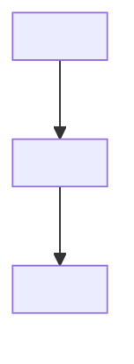

# PLAN.md Format

The dependency DAG + ordered node list. Written after plan approval, updated as nodes land. The status column is the single source of truth for where teaching stands; SESSION.md records the finer-grained position (mid-node).

````md
# Plan: <Topic>

## Approach
<2-4 sentences: the teaching path and why it fits the baseline and mission>

## Dependency map


## Nodes
| # | Node | Status |
|---|------|--------|
| 1 | <node (root: unconditional truth)> | done |
| 2 | <derived node> | done |
| 3 | <derived node> | in-progress |
| 4 | <derived node> | not-started |
````

Render the actual DAG in the map section: unconditional truths at the roots, each derived node hanging off its dependencies, the goal as the sink. Small map, short labels — a map, not the territory. Every node in the table appears in (or is a leaf of) the DAG.

Supplementary gap-filler lessons get appended as their own rows (`3b`), marked `supp`, and are **not** part of the main DAG — they patch, they don't extend.